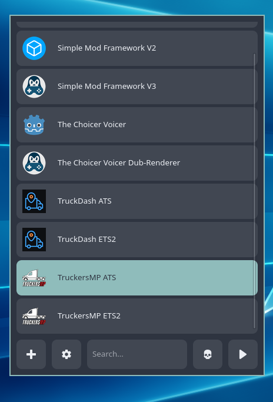
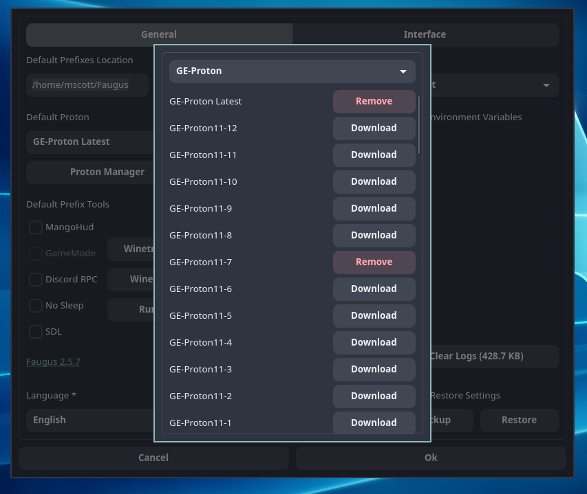
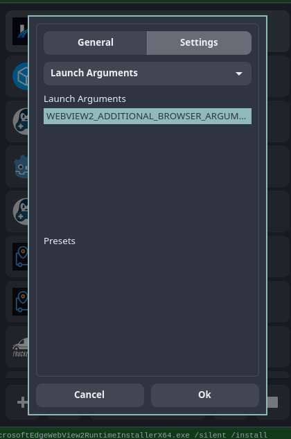
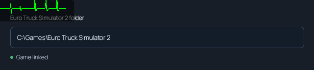
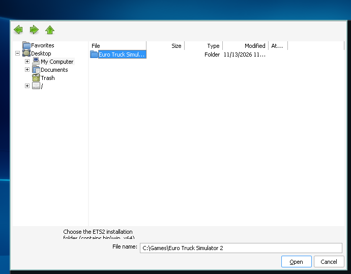

# Guide for installing and running TruckersMP or HaulMP on Linux via Proton
### Prerequisites:
- Steam (System package preferred)
- Faugus Launcher
- Proton-GE Latest
- HaulMP Installer from https://haulmp.com/download
- TruckersMP Installer from https://truckersmp.com/download
- wine
- winetricks
- protontricks
- yad
- zenity
- A Free Spirit

**I am aware that the TMP team have a linux-launcher in the form of a proton fork, but my testing has shown this has not worked**

### TruckersMP Install
TruckersMP must be installed in it's own prefix using wine, and then run in the ETS2/ATS Prefix, for this tutorial we will be making a folder in /home, /ProtonGames respectively
1. Head over to the TruckersMP website and download the TruckersMP-Setup.exe
2. Open up a terminal of your choosing and run
```
mkdir -p $HOME/ProtonGames/TruckersMP/
```
```
WINEPREFIX=$HOME/ProtonGames/TruckersMP/ wine $HOME/Downloads/TruckersMP-Setup.exe
```
3. The above commands created the TruckersMP install directory and wine installed TruckersMP client to that prefix which will be located in
```
$HOME/ProtonGames/TruckersMP/drive_c/users/$USER/AppData/Local/TruckersMP/TruckersMP-Launcher.exe
```
### HaulMP Install
HaulMP is same same but different, as unlike TruckersMP, the HaulMP program needs to be installed into the ETS2 prefix itself
1. First make sure Steam is fully closed, and then we'll need a few dependencies for the tablet to work, it will take around 1-2 minutes and no window
```
curl -L -o $HOME/Downloads/MicrosoftEdgeWebView2RuntimeInstallerX64.exe "https://go.microsoft.com/fwlink/?linkid=2124701"
protontricks-launch --appid 227300 $HOME/Downloads/MicrosoftEdgeWebView2RuntimeInstallerX64.exe /silent /install
```
2. Next install HaulMP into the ETS2 Prefix via Protontricks. 
```
protontricks-launch --appid 227300 $HOME/Downloads/HaulMP-Setup.exe
```
### Faugus Setup

We are using Faugus over Lutris, Bottles and Heroic because it looks nice and has UMU which will be needed to actually launch ETS2/ATS

**For TruckersMP, we will need to do this process twice for both games. (HaulMP only has ETS2 support currently, but the process once ATS is supported, would be to copy the HaulMP install instructions but substitute 227300 with 270880)**

**Faugus does not expand $HOME or $USER, please make sure to replace $USER with your username, ie mscott**

1. Open up Faugus Launcher and click the + button

2. Set title to TruckersMP ETS2, the path to 
```
/home/$USER/ProtonGames/TruckersMP/drive_c/users/$USER/AppData/Local/TruckersMP/TruckersMP-Launcher.exe
```
3. set prefix to
```
/home/$USER/.local/share/Steam/steamapps/compatdata/227300
```
4. and change the Proton to Proton-GE Latest, if you do not have Proton-GE latest, you can use Faugus' built in proton manager. 
(click the settings button and in General tab click Proton Manager and choose Proton-GE Latest/GE-Proton Latest from the dropdown menu)


5. For installing TruckersMP to ATS repeat the last 4 steps but replace the prefix 227300 to 270880

### HaulMP Setup

1. Open up Faugus Launcher and click the + button

2. Set title to HaulMP ETS2, the path to 
```
/home/$USER/.local/share/Steam/steamapps/compatdata/227300/pfx/drive_c/users/steamuser/AppData/Local/HaulMP/HaulMP.exe
```
3. set prefix to
```
/home/$USER/.local/share/Steam/steamapps/compatdata/227300
```
4. and change the Proton to Proton-GE Latest, if you do not have Proton-GE latest, you can use Faugus' built in proton manager. 
(click the settings button and in General tab click Proton Manager and choose Proton-GE Latest/GE-Proton Latest from the dropdown menu)


5.Add the following to launch arguments:
```
WEBVIEW2_ADDITIONAL_BROWSER_ARGUMENTS="--no-sandbox --disable-gpu"
```



6. We will need to symlink ETS2 Game folder to the virtual prefix so Haul can see it
```
mkdir -p "$HOME/.local/share/Steam/steamapps/compatdata/227300/pfx/drive_c/Games/"
```
```
ln -s "$HOME/.local/share/Steam/steamapps/common/Euro Truck Simulator 2" "$HOME/.local/share/Steam/steamapps/compatdata/227300/pfx/drive_c/Games/"
```

### Game Setup
In HaulMP set the game path to C:\Games\Euro Truck Simulator 2, you should able to find it in the Wine File Picker Dialogue in My Computer -> C: -> Games -> Euro Truck Simulator 2, and then click open.





In TruckersMP set the game paths as so ($USER will not expand, so please put in your username.)

```
Z:\home\$USER\.local\share\Steam\steamapps\common\Euro Truck Simulator 2\
```
```
Z:\home\$USER\.local\share\Steam\steamapps\common\American Truck Simulator\
```

and repeat this step for TruckersMP ATS

**Tested on Arch Linux, with Steam as a system package**
